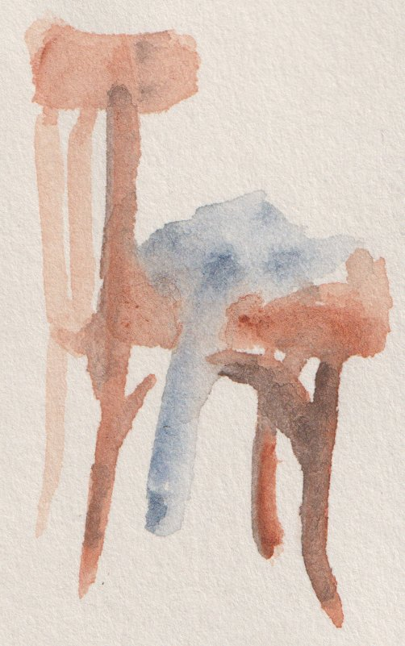

# Rachel's Handicrafts

A quirky, hand-drawn website for **Rachel's Handicrafts** — bespoke, local, ethical and sustainable
textiles, made by hand in Perth, WA on a Bernina 930 Record.

The shop is one small Rust program (axum, with pages written in maud and a little
[fixi.js](https://github.com/bigskysoftware/fixi)) that runs on the shop's OpenWrt router behind its
HTTPS reverse proxy. It serves the pages, takes orders into a SQLite database, emails the customer a
copy and Rachel a notification, and gives each order a pay link for Monero (through
[Monokulo](https://docs.monokulo.com)) or PayID / bank transfer. Rachel keeps track of orders at
`/admin`. It's packaged as one OpenWrt `.apk` with its LuCI settings page inside, built the same way
as Monokulo's.

The product catalogue and the recipes are still JSON files you edit directly, and the cart still
lives in the browser (`localStorage`).

## Structure

```
src/main.rs          Starts the server; also `hash-password`, `check`, `send-test-mail`
src/config.rs        Settings, from HANDICRAFTS_* environment variables (LuCI fills them in)
src/catalog.rs       Reads data/products.json and data/recipes.json; prices orders
src/views/           The pages, in maud:
  layout.rs            the shared <head>, header and footer — edit the nav ONCE, here
  shop.rs              home, shop, cart, recipes, one recipe, the donation panel
  checkout.rs          checkout, "order received", the pay page
  admin.rs             /admin
src/web/             The routes: shop.rs (pages, placing orders), pay.rs, webhook.rs (Monokulo),
                     admin.rs (Basic auth, CSRF); tests.rs runs whole orders end to end
src/db.rs            SQLite: orders, their timeline, Monokulo payments, the email outbox
src/orders.rs        Order statuses and which changes are allowed
src/emails.rs        The emails, as HTML and plain text
src/mail.rs          Sending: SMTP, or a Tuta account through Tern's tern-tuta crate
src/outbox.rs        Sends queued emails, retrying when the mail server is down
src/monokulo.rs      Monokulo: connecting the store, making payments, checking webhook signatures
src/invoice.rs       The Invoice button's email draft (.eml) from the template
src/ratelimit.rs     Spam limits and the client's real IP behind the proxy
src/assets.rs        css/, js/, assets/ and data/products.json, compiled into the binary

css/style.css        The shop's styling (hand-drawn/quirky theme, one file)
css/admin.css        /admin's plain styling
js/products.js       Loads data/products.json, renders product cards
js/cart.js           Cart logic (localStorage)
js/cart-page.js      Renders cart.html
js/checkout.js       Fills the checkout's summary and sends the cart with the order
js/pay.js            Reloads the pay page once the order is paid
js/admin.js          Small /admin helpers
js/fixi.js           fixi.js 0.9.4, vendored
js/fixi-forms.js     Makes fixi send forms URL-encoded, like a plain form post
js/main.js           Shared bits: mobile nav, footer year, nav highlighting, copy buttons

data/products.json   ← THE FILE YOU EDIT to add/change/remove products
data/recipes.json    ← THE FILE YOU EDIT to add/change/remove recipes

openwrt/             The OpenWrt package: Makefile, init script, UCI defaults, LuCI page, rpcd backend
scripts/             build-openwrt.sh (the .apk), test-openwrt.sh (installs it in OpenWrt) and
                     test-browser.sh (the whole flow in a real browser, tests/browser/flow.mjs)

assets/doodles/      Hand-drawn SVG illustrations (logo, sewing machine, icons)
assets/products/     Product photos
assets/art/          Rachel's own scanned sketches/watercolours, used as background decor
```

Email through Tuta uses [Tern](https://github.com/OceanEilonwy/tern)'s `tern-tuta` crate (pinned to a
commit in `Cargo.toml`), which signs in with Tuta's own SDK. Tern and the SDK are GPL-3.0 and are
linked into the binary, so the program is GPL-3.0 too.

## Editing the product list

Open `data/products.json` in any text editor. It's a plain JSON array — one object per product:

```json
{
  "id": "tote-bag",                  // unique, no spaces — used internally (cart, URLs)
  "sku": "RH-TOTE-01",
  "name": "Tote Bag",
  "price": 42,                       // number, no $ sign. Use null for "custom quote" items
  "currency": "AUD",
  "category": "Bags",
  "materials": "100% cotton canvas, cotton webbing straps",
  "description": "A sturdy everyday tote...",
  "image": "assets/products/tote-bag.svg",
  "images": [                        // optional — use instead of "image" for several photos
    "assets/products/tote-bag.svg",
    "assets/art/tote_bag.jpg"
  ],
  "madeOn": "Bernina 930 Record",
  "comingSoon": true,                // optional — parks the product: greyed-out "Coming soon!" instead of Add to Cart
  "swatches": [                      // optional — adds a fabric colour picker to the card
    { "name": "Natural Linen", "hex": "#e8ddc8" },
    { "name": "Gingham Blue",        // a swatch can show a fabric photo/pattern instead of a flat colour
      "image": "assets/swatches/gingham-blue.svg",
      "hex": "#8fb2c9",              // optional with an image — shown behind it while the image loads
      "materials": "Cotton/linen blend, hand-rolled hem" }   // optional — overrides the Materials line
  ]
}
```

To add a product: copy an existing block, give it a new `id`, and fill in the details. There's no
stock tracking — everything is made to order in small batches, so every product just stays listed.
Add a `swatches` array to offer a colour choice (shown as a compact, expandable fabric swatch
picker); leave it out for products that don't need one. Each swatch is drawn from either a `"hex"`
colour or an `"image"` (any `.svg`/`.jpg`/`.png` — keep them square, `assets/swatches/` is the
natural home for them); give both and the image is what shows, with the hex behind it as the
fallback. A swatch can also carry its own `"materials"` string for fabrics whose composition differs
from the product default — that line then replaces the card's Materials text whenever that fabric is
selected, the card gets a "varies by fabric" flag so shoppers know to check it, and the chosen
fabric's composition is carried through to the cart, the saved order, the order emails and the invoice. Set `"comingSoon": true` on anything you're
still making but want listed — the card shows as normal (price, swatches and all) with a greyed-out
"Coming soon!" in place of the Add to Cart button, and it can't reach the cart or an order. Set
`"price": null` for something like a
custom/bespoke service — the card shows "Custom quote" and an "Enquire" button instead of a price
and Add to Cart. To swap in a real photo instead of the hand-drawn placeholder, just point `"image"`
at a `.jpg`/`.png` in `assets/products/` (any image works, square-ish photos look best). For several
photos of the same piece, use an `"images"` array instead — the card then gets ‹ › arrows to step
through them, a ⤢ button that opens the photo full-size in a dialog (arrow keys and Esc work there),
and a small "1 / 3" counter. The first photo in the list is the one used everywhere else (cart rows,
the order pages), so lead with your best shot.

### Image sizes (important when adding photos)

Every page points images at a `.webp` and falls back to the original `.jpg`/`.png` only if that
file is missing. **Product gallery photos ship at two sizes:**

| file | size | used for |
|---|---|---|
| `gallery_1.webp` | 600px | the card carousel — this is the one preloaded |
| `gallery_1_full.webp` | full res | the lightbox, fetched only when someone expands a photo |
| `gallery_1.jpg` | original | fallback if webp is unsupported |

The split is what makes the carousel instant: every card-sized photo is preloaded in the background
after the page loads (see `preloadProductImages` in `js/products.js`), so stepping a carousel costs
no download at all. Opening the lightbox shows that already-loaded 600px image immediately, then
fades the full-resolution copy in over it once it arrives.

**After adding or replacing any `.jpg`/`.png`**, generate the sizes it needs:

```
magick photo.jpg -resize '1600x1600>' -quality 82 photo_full.webp
```

```
magick photo.jpg -resize '600x600>' -quality 82 photo.webp
```

Swatch images only ever render as a 56px tile, so they need just the one small file:

```
magick swatch.jpg -resize '160x160>' -quality 82 swatch.webp
```

(`magick` is ImageMagick; `brew install imagemagick` / `apt install imagemagick` if you don't have
it.) Skipping this isn't a hard failure — a photo with no `_full.webp` simply stays at card
resolution in the lightbox, and one with no `.webp` at all falls back to the original — but the
sizes matter: the full set of card photos is 507KB, where shipping the originals to every visitor
was 2.2MB. `.svg` icons and doodles don't need any of this.


## Editing recipes

Open `data/recipes.json` — a plain JSON array, one object per recipe, same pattern as
`data/products.json`. The shop turns each entry into its own page, `recipe-<id>.html`, from the
one recipe template (`recipe()` in `src/views/shop.rs`) — add a recipe here, rebuild, and a page for
it appears automatically; there's no HTML to write by hand.

```json
{
  "id": "scones",                    // unique, no spaces — becomes the page's filename
  "title": "Scones",
  "tagline": "A deliciously simple recipe for the novice, the dabbler and the seasoned baker alike!",
  "accent": "gold",                  // gold, clay or sage — the site's three accent colours
  "byline": "A family recipe contributed by <span class=\"author\">Emily Bell</span>.",
  "donation": false,                 // true adds the Monero donation disclosure to the footer
  "note": "Optional — a callout box shown between the method and the footer. Omit if not needed.",
  "credit": "Optional — a small credit line above the byline, e.g. crediting an inspiration recipe. Can contain a <a href=\"...\">link</a>.",
  "ingredients": [
    "<span class=\"number\">4</span> cups self raising flour"
  ],
  "method": [
    "Bake in an oven heated to <span class=\"number\">200°C</span> fan force for <span class=\"number\">15</span>–<span class=\"number\">20</span> minutes."
  ]
}
```

`ingredients` and `method` are each a list of raw HTML strings rendered as-is (maud's
`PreEscaped`), not plain text — that's deliberate, not an oversight, and it's what lets a single
ingredient line mix quantities, fractions and free text however it needs to. Wrap anything you want
visually called out — a temperature, a time, a quantity — in `<span class="number">...</span>`; the
CSS turns those into the gold pills in the method list and bolds them in the ingredients list. Since
these are raw HTML, escape any literal `<`, `>` or `&` in the recipe text itself (e.g. `&amp;`), and
never paste in HTML from a source you don't trust — it renders unescaped, exactly as written.

Ingredients get a click-to-tick checkbox automatically — that's pure CSS (`:checked` + a sibling
selector), no JavaScript, and nothing persists between visits, matching how the original recipe site
this was migrated from worked.

The Monero donation panel (QR code + address) is one shared piece, `donation()` in
`src/views/shop.rs` — the address lives there once, not per-recipe; set `"donation": true`
on any recipe that should show it, rather than editing the address in multiple places.


## Running it locally

```bash
HANDICRAFTS_MAIL=log cargo run
```

Then open `http://localhost:8082`. With `HANDICRAFTS_MAIL=log`, emails are printed to the terminal
instead of sent. The database goes in `data-dev/` (gitignored). In a debug build CSS, JS and images
are read from disk, so edits show up on reload; Rust changes (pages, routes) need the `cargo run`
again. You need Rust — install it from [rustup.rs](https://rustup.rs) if `cargo` isn't found.

To try `/admin`, make a password hash and pass it in:

```bash
echo 'a long password' | cargo run -q -- hash-password
```

```bash
HANDICRAFTS_MAIL=log HANDICRAFTS_ADMIN_PASSWORD_HASH='<the hash>' cargo run
```

`cargo run -- --help` lists every setting. `cargo test` runs the tests, including whole orders end to
end against a fake Monokulo. `scripts/test-browser.sh` runs the whole flow in a real browser
(Chromium, through playwright-core): checkout, `/admin`, the invoice, connecting Monokulo and both ways
of paying, with screenshots in `target/browser-test/`. It needs Node and Chromium (`CHROME=` if it
isn't `/usr/bin/chromium`).

## How orders and payments work

1. **Checkout.** The checkout form posts the cart to `/orders`. The server prices it from
   `data/products.json` (the browser's prices are never trusted), saves it as **New**, and queues two
   emails: a copy for the customer and a notification for Rachel. The customer sees the "order
   received" page. Nothing is charged.
2. **Admin.** At `/admin` (HTTP Basic auth, username and password set in LuCI) Rachel sees each order,
   adds comments, and records its status: New → Invoiced or Rejected → Paid → Dispatched → Completed.
   Invoiced, Paid, Dispatched and Completed need **Accepted** ticked. The app is a record: Rachel does
   the work (emails, calls, posting) and writes down what happened.
3. **Invoice.** The Invoice button downloads an email draft (`.eml`) that opens unsent in Outlook,
   Thunderbird or Apple Mail, from the template at `/admin/settings`. The template must contain
   `{{ pay_link }}`; `{{ bank_ref }}` is the order's short bank reference (5 characters, like
   `K7P4Q`). Rachel sends it, then sets the order to Invoiced.
4. **Paying.** The pay link opens `/pay/<secret>`:
   - **Monero** (preferred): the shop makes a Monokulo order for the AUD total with the store's secret
     key and shows its address, QR code and progress in a card of its own. When Monokulo sends its signed `order.paid` webhook to
     `/webhooks/monokulo`, the order moves to **Paid** on its own, with a timeline comment holding the
     amount, rate and the customer's refund address. A payment whose amount doesn't match never
     marks an order paid. If Monokulo can't price in AUD, the customer is told and offered bank
     transfer, and Rachel is emailed and sees a banner on `/admin`.
   - **PayID / bank transfer**: the page shows the details from LuCI and the short reference. "I've
     sent the payment" emails Rachel but changes nothing: she checks the bank and sets Paid herself.

Emails go through an outbox in the database: if the mail server or Tuta is down, the order is still
saved and the email retries for about a day. Failed emails show on `/admin` with a Resend button.

**Spam limits:** 3 orders per IP in 10 minutes and 10 a day; at most 3 order emails to one address a
day (after that the order is still taken, without the customer's copy); 40 orders a day for the whole
shop. There's also a hidden honeypot field and a minimum time on the checkout page. The client's IP
comes from the reverse proxy's `X-Forwarded-For`, believed only from the trusted proxy addresses.
All of these are set in LuCI.

## The background artwork

The paper texture and the faint sketches sitting in the hero, section headers and footers
(`assets/art/*.jpg`) are Rachel's own scanned watercolours and pencil sketches — resized and
compressed for the web from the full-resolution originals in `/art/` (that source folder is
gitignored; it's just working material, not something the site loads).

Each one is dropped in with:

```html

```

`.art-decor` (in `css/style.css`) does the actual work: `mix-blend-mode: multiply` drops out each
scan's own paper tone (since it's close to the site's `--paper` colour), leaving just the ink or
watercolour marks, and a radial-gradient mask fades the rectangular edges to nothing — so it dissolves
into the page instead of sitting on top of it as a visible photo rectangle. The site's own background
(`assets/art/paper_bg_100.webp`) is a seamless tile cropped from a blank corner of one of the same
scans, so the page itself is made of the same paper the art is on.

That texture loads in two stages: the CSS starts on `paper_bg_40.webp` (~22KB) so the grain is there
at first paint, and `js/bg-swap.js` upgrades to the full-resolution `paper_bg_100.webp` (~445KB) once
it has downloaded, then records that in `localStorage`. On every later page load a small inline
script in the `<head>` reads that flag and applies the full-res version *before* first paint, so the
upgrade is only ever visible once — otherwise every navigation would visibly snap from blurry to
sharp. Anything that paints the texture must also set `background-color: var(--paper)`, or there is
nothing to paint until the image lands and it flashes white.

How fine the grain reads is `--paper-tile` in `:root` (currently `150px`) — smaller means more
repeats per screen and a denser, more detailed texture.

To add another piece: drop a resized/compressed image in `assets/art/`, add an `` where you want it, and give `.your-new-class` a `width`, a position (`top`/`left` or
`bottom`/`right`), and an `opacity` in the CSS. The parent element needs `position: relative` (and
usually `overflow: hidden`) for the absolute positioning to stay contained — `.hero`, `.site-footer`,
`.page-header` and `.confetti-band` already have this set up as examples. All `.art-decor` pieces
hide automatically under 700px width to keep things uncluttered on mobile.


## Installing on the router

The router is the GL.iNet Flint 2 that runs Monokulo (OpenWrt 25.12, `aarch64_cortex-a53`). CI builds
the package on every push (`.github/workflows/release.yml`); to build it yourself, with Docker:

```bash
scripts/build-openwrt.sh
```

That makes `dist/handicrafts-<version>.apk`, signed with the same key as Monokulo's and Kringle's
packages (`openwrt/keys/monokulo.pem`), so a router that has Monokulo trusts it already. Copy it over
and install it:

```bash
scp dist/handicrafts-*.apk root@router:/tmp/
```

```bash
ssh root@router apk add /tmp/handicrafts-*.apk
```

Then in LuCI, **Services › Handicrafts**:

1. **General**: the shop's address (`https://www.rachelshandicrafts.com`), the admin username and
   password, and the admin email.
2. **Email**: "From a Tuta account" with the account's address and password (or SMTP), and **Send
   from**: the account's own address, or one of its aliases such as `hello@rachelshandicrafts.com`.
   The sender's name is the one set in Tuta. Accounts with two-factor sign-in can't be used, so use
   a separate sending account without it. Save & Apply, then **Send test email**.
3. **Payments**: PayID and bank details, and the Monokulo address (`https://www.monokulo.com`). Save &
   Apply, then open the shop's **Monero** page (`/admin/monokulo`) and press **Connect to
   Monokulo**: you sign in to Monokulo and confirm, and the shop fetches the store's keys and adds its
   webhook by itself (Monokulo's plugin connect flow, under the name `handicrafts`). **Send a test
   webhook** there checks payments notices get through. Monokulo finds the store by the shop's
   address and makes one if there isn't one, and needs its own public address set in its admin
   settings. Keys can still be pasted into LuCI by hand instead; a connected store takes over from
   them.
4. Point the reverse proxy at `127.0.0.1:8082`.

Secrets (the admin password's hash, mail passwords, Monokulo keys) are kept in root-only files in
`/etc/handicrafts/secrets/`, never in UCI. Settings, secrets and the database (`/srv/handicrafts`)
survive firmware upgrades. `logread -e handicrafts` shows the log; a bad setting stops the shop at
start-up with the reason there and on the LuCI page.

**CI and the apk repository.** CI needs the repository secret `APK_SIGNING_KEY` (the private key
that signs Monokulo's packages). Every push to master also publishes the signed apk repository on
GitHub Pages, so the router can `apk upgrade`. Pages used to serve the shop itself, so the first push
replaces the old static shop there: point the domain at the router and remove the custom domain under
Settings › Pages before that.

## Making a change later

```bash
# edit data/products.json, src/, css/, or any file
git add -A
git commit -m "Add new scarf print to the shop"
git push
```

CI tests it and builds the package. Install the new `.apk` on the router (or `apk upgrade` once the
repository is published); the package restarts the shop on upgrade. Stylesheets and scripts are linked
with a hash of their contents, so returning visitors get the new version without any manual
cache-busting.
